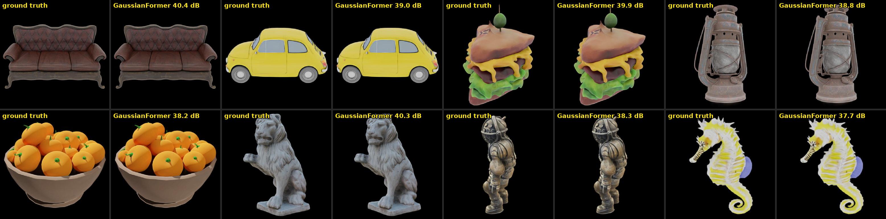
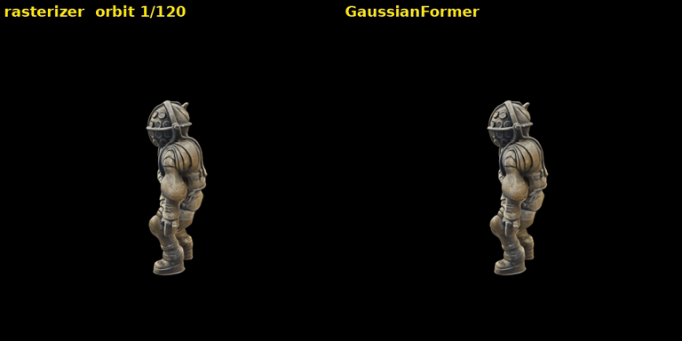
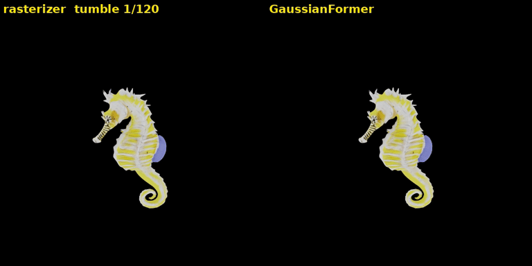
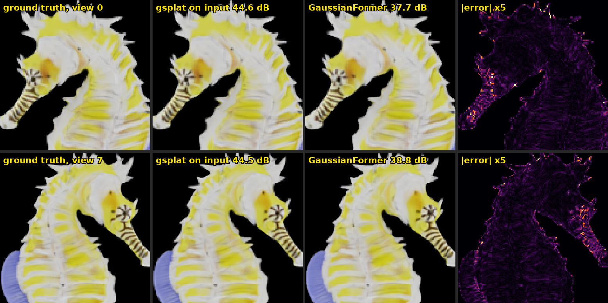

<h1 align="center">GaussianFormer: Transformer Rendering of 3D Gaussian Splats</h1>

<p align="center">
  <a href="https://huggingface.co/shahafvl/gaussianformer"><strong>Pretrained model</strong></a>
  ·
  <a href="https://huggingface.co/collections/shahafvl/gaussianformer-6abb727b461d7c89d5308f1c"><strong>All checkpoints</strong></a>
  ·
  <a href="https://github.com/microsoft/renderformer"><strong>RenderFormer</strong></a>
</p>

GaussianFormer renders 3D Gaussian Splatting scenes with a transformer, without per-scene optimization. It adapts
[RenderFormer](https://github.com/microsoft/renderformer) (SIGGRAPH 2025), a transformer renderer for triangle
meshes: each Gaussian becomes one scene token, and the two-stage architecture is warm-started from RenderFormer's
pretrained weights.

<div align="center">
  
  <em>Eight objects never seen in training: ground truth (full splat) and GaussianFormer, PSNR on the crop around the
  object.</em>
</div>

<div align="center">
  
  
  <em>Two held-out objects, rasterized (left) and rendered by GaussianFormer (right): a camera orbit and a tumbling
  object.</em>
</div>

<div align="center">
  
  <em>A held-out object up close: ground truth, rasterization of the 20k-Gaussian input, GaussianFormer, and its
  absolute error.</em>
</div>

## Results

300 objects held out from training and never used while developing the model, PSNR on the square crop around the
object against the full-splat ground truth, over all 28 training views (14 at camera distance 1.7, 7 each at 1.15
and 2.45) and over 4 of them (views 0, 4, 7 and 11 at distance 1.7):

| | 28 views | 4 views | SSIM | LPIPS |
|---|---|---|---|---|
| gsplat rasterization of the same 20k-Gaussian input | 44.02 | 44.97 | 0.9954 | 0.0046 |
| **GaussianFormer** | **38.08** | **38.36** | **0.9814** | **0.0113** |

By camera distance, GaussianFormer scores 38.47, 38.38 and 37.08 dB at 1.15, 1.7 and 2.45 (rasterization 42.39,
45.14 and 43.39). On 300 training objects, at their 28 training views, it scores 38.25 dB, 0.17 dB above the
held-out objects.

## Installation

Linux with an NVIDIA GPU and Python 3.12, with [uv](https://docs.astral.sh/uv/). To use the model in your own
project:

```bash
uv add "gaussianformer @ git+https://github.com/SVLwoof/gaussianformer"
```

This installs PyTorch 2.9 for CUDA 12.8. [Flash Attention](https://github.com/Dao-AILab/flash-attention) is optional
and recommended for speed: without it the model falls back to PyTorch's scaled-dot-product attention. The `flash`
extra adds a prebuilt wheel:

```bash
uv add "gaussianformer[flash] @ git+https://github.com/SVLwoof/gaussianformer"
```

In a virtual environment without a uv project, `uv pip install` takes the same arguments. To train, evaluate or
build the dataset, clone the repository and run `uv sync`, which installs the locked environment, Flash Attention
included. gsplat compiles its CUDA kernels on first use.

pip does not read uv's package sources, so with pip install the Flash Attention wheel yourself if you want it:

```bash
pip install "gaussianformer @ git+https://github.com/SVLwoof/gaussianformer"
pip install https://github.com/Dao-AILab/flash-attention/releases/download/v2.8.3/flash_attn-2.8.3+cu12torch2.9cxx11abiTRUE-cp312-cp312-linux_x86_64.whl  # optional
```

## Rendering

From a 3D Gaussian Splatting PLY (the standard format written by 3DGS trainers):

```bash
uv run python -m tools.ply_to_h5 --ply object.ply --out object.h5 --up z   # --up: the file's up axis (y, z or -y)
uv run python infer.py --h5 object.h5 --out renders/                        # one PNG per camera
```

In Python:

```python
import torch
from gaussianformer import GaussianFormerRenderingPipeline, load_ply
from gaussianformer.utils.cameras import orbit

pipeline = GaussianFormerRenderingPipeline.from_pretrained("shahafvl/gaussianformer").to("cuda")
gaussians = load_ply("object.ply", up="z")     # [N, 14]
c2w = torch.from_numpy(orbit(8, 1.7))          # [V, 4, 4] camera-to-world (-Z forward, +Y up)
images = pipeline(gaussians, c2w, fov=45.0)    # [V, 512, 512, 3]
```

The model takes each Gaussian as 14 activated values, pos(3) | scale(3) | quat wxyz(4) | rgb(3) | opacity(1): linear
scales, a unit quaternion, colors and opacity in [0, 1]. A PLY stores log scales, raw quaternions, spherical-harmonic
coefficients and opacity logits instead; `load_ply` (`gaussianformer/splat.py`) converts them, keeps only the
degree-0 color, and puts the object in the frame the model is trained on: centered, Y-up and scaled into
[-0.45, 0.45]³. It also prunes the splat to 20k Gaussians, the size the model is trained on, and fine-tunes the kept
Gaussians against the full splat (about a minute on a GPU; `recovery=False` / `--no_recovery` skips it).
Cameras should be 1.15 to 2.45 units from the object with a 45° field of view.

`infer.py` renders the cameras stored in an HDF5 scene: `means [N,3]`, `scales [N,3]`, `rotations [N,4]` (w,x,y,z),
`colors [N,3]`, `opacities [N,1]`, `c2w [V,4,4]` and `fov [V]`. `tools/render_video.py` renders orbit, dolly and
motion clips next to the rasterized input.

## Model

| Stage | Tokens | Layers |
|---|---|---|
| Scene encoder | one per Gaussian (a linear map of its 14 parameters), plus 16 registers; 3-D RoPE on positions | 12 self-attention layers, view-independent |
| View decoder | one per 4×4-pixel patch, from its ray directions | 6 layers of cross-attention to the scene tokens and patch self-attention, then a DPT head |

Changes over RenderFormer besides the input tokens (options in `gaussianformer/models/config.py`):

- `proj_rope_2d`: each Gaussian is projected into the view, and its image position enters the cross-attention as a
  2-D RoPE matched against each patch's position.
- `cov_key_embed`: each Gaussian's covariance is projected into the view, and its footprint in the image (the sizes
  and orientation of its two axes) is added to the Gaussian's key in the cross-attention through a zero-initialized
  linear layer per decoder layer, so each patch can tell how far a Gaussian reaches.
- `patch_size=4` with `ray_embed_patch=8`: 4 px patches (RenderFormer: 8 px) that reuse the pretrained 8 px ray
  embedding.

Every patch attends to every Gaussian. `xattn_window` (`gaussianformer/layers/window.py`) restricts each 8×8-patch
tile to the Gaussians whose projected footprint reaches it, which saves memory in training but is not used by the
released model; it needs Flash Attention on GPU.

## Data

```bash
scripts/prepare_data.sh
```

For each object of [Objaverse_Splats](https://huggingface.co/datasets/ShapeSplats/Objaverse_Splats) listed in
`data/splits/` (`data/prepare.py`):

1. Normalize the splat and render 28 ground-truth views of it with gsplat: 14 at distance 1.7, 7 each at 1.15 and
   2.45.
2. Keep its 20k most important Gaussians ([LightGaussian](https://github.com/VITA-Group/LightGaussian) score) and
   fine-tune them to match the full splat.

The result is `data/{train,val}/h5s/scene_*.h5` (inputs and cameras) and `data/{train,val}/renders/` (targets):
26,820 training and 1,806 validation objects.

## Training

```bash
scripts/train.sh
```

`training/train.py` is a data-parallel trainer with a warmup-stable-decay learning rate that resumes from its newest
checkpoint. The released model is trained in four stages on 8 GPUs:

| Stage | Resolution | Trains | Steps | Loss |
|---|---|---|---|---|
| 1 | 256 | Gaussian input head, RenderFormer backbone frozen | 33.5k | log L1 |
| 2 | 256 | everything | 402k | log L1 |
| 3 | 256 | everything, with the three changes above switched on | 3k | log L1 |
| 4 | 512 | everything | 385k | log L1 + LPIPS |

The log-L1 term compares log10(image + 1) and weights background pixels by 0.05 from stage 3 on.

## Evaluation

```bash
uv run python evaluate.py --data data/val --objects data/splits/heldout300.json
uv run python -m tests.test_model && uv run python -m tests.test_splat   # CPU tests
```

## Acknowledgements

Built on [RenderFormer](https://github.com/microsoft/renderformer) by Chong Zeng, Yue Dong, Pieter Peers, Hongzhi Wu
and Xin Tong, whose architecture, attention layers and DPT decoder form the backbone of this project. The training
data is the Objaverse_Splats subset of [Objaverse](https://objaverse.allenai.org/); ground truth is rendered with
[gsplat](https://github.com/nerfstudio-project/gsplat).

## License

- **Code:** MIT.
- **Weights:** MIT. The model is trained on [Objaverse_Splats](https://huggingface.co/datasets/ShapeSplats/Objaverse_Splats),
  splats fit to [Objaverse](https://objaverse.allenai.org/) objects, each of which keeps its creator's license.

## Citation

A paper on GaussianFormer is in preparation and will be presented at a later date; its citation will be added here.

GaussianFormer builds on RenderFormer; please also cite:

```bibtex
@inproceedings{zeng2025renderformer,
  title     = {RenderFormer: Transformer-based Neural Rendering of Triangle Meshes with Global Illumination},
  author    = {Chong Zeng and Yue Dong and Pieter Peers and Hongzhi Wu and Xin Tong},
  booktitle = {ACM SIGGRAPH 2025 Conference Papers},
  year      = {2025}
}
```
